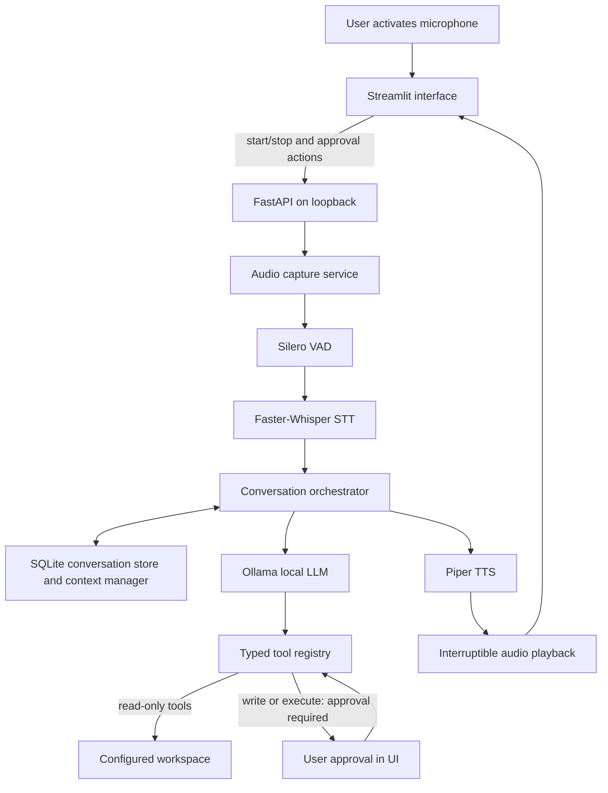

# Offline Speech-to-Speech AI Agent

## Milestone 1: Repository Audit and Architecture

### Audit scope and findings

The selected `Sunil GIT` directory is an aggregation folder containing approximately 29 child Git repositories; it is not itself a Git repository. The audit searched the aggregate for voice, audio, transcription, Faster-Whisper, Piper, Silero VAD, and Ollama references, then inspected representative LLM, agent, configuration, API, and Streamlit code in adjacent projects.

- No existing voice assistant, speech-to-text, text-to-speech, microphone-capture, or VAD implementation was found.
- `enterprise-ai-data-copilot` has an LLM provider abstraction and an OpenAI-compatible adapter that can target Ollama, but its factory selects a mock provider by default and its application is a data copilot. It is not a reusable offline voice-agent package.
- That project also has separated API, agent, configuration, database, and observability modules. These are useful organizational examples, not dependencies to import across repository boundaries.
- `streamlit-openai-chatbot` has a small chat-history/message builder and Streamlit frontend, but it depends on an external-compatible LLM design and has no persistent voice workflow.
- `AI-Agent-Jira-Integration` separates agent tools, schemas, API, services, and configuration. It is an adjacent example for tool boundaries, not a component to reuse directly.
- The other child projects are independent applications and learning repositories; this new application will not modify or couple to them.

This is an aggregate-level audit plus targeted inspection of the closest adjacent projects, not a line-by-line review of all 29 repositories.

### Architecture goals and invariants

1. All runtime inference and speech processing stays on the user's machine.
2. The API binds to loopback by default. Ollama is reached only through its local interface; model downloads are an explicit setup action, never an inference-time dependency.
3. Microphone capture starts only after a user action, exposes a visible listening state, and can be stopped or interrupted.
4. Raw audio is not retained by default. Transcripts and conversation history are stored locally with user controls to inspect and delete them.
5. Tools have typed inputs, workspace-scoped file access, and explicit risk/approval policies. File writes and code/test execution require user approval.
6. The LLM can request a registered tool, but cannot provide arbitrary shell commands for direct execution.
7. Speech, model, persistence, agent, API, and UI logic remain independently testable and injectable.

### Proposed component flow



### Proposed module boundaries

```text
app/
  main.py
  config.py
  api/
    routes/
    schemas/
  core/
    orchestrator.py
    agent.py
    tool_registry.py
    context_manager.py
    permissions.py
  services/
    audio_service.py
    vad_service.py
    stt_service.py
    llm_service.py
    tts_service.py
  memory/
    conversation_store.py
    memory_manager.py
  tools/
    file_tools.py
    document_tools.py
    coding_tools.py
  frontend/
    streamlit_app.py
    components/
  utils/
tests/
  unit/
  integration/
scripts/
models/
data/
logs/
```

The project will use a `pyproject.toml` for Python packaging, dependency groups, and test/lint configuration, plus `.env.example` for documented settings. Model files, audio, database files, logs, and local secrets must be excluded from version control. The layout may be adjusted when implementation reveals actual package constraints; modules will only be added when needed.

### Service responsibilities

- **Audio capture and VAD:** `MicrophoneCapture` opens a `sounddevice` input stream only when called, uses 512-sample frames at 16 kHz (256 at 8 kHz), and uses Silero streaming probabilities to find speech boundaries. It retains a short pre-roll, closes an utterance after configurable silence, limits utterance/listen duration, supports cancellation, and rejects concurrent captures or dropped callback frames.
- **STT:** `FasterWhisperService` loads lazily on CPU/int8 by default and accepts configurable model path/size, device, compute type, beam size, and optional language. Automatic language detection is the default. Runtime model downloads are disabled; model setup must populate the local cache before transcription. Empty input returns an empty result without model loading, while model-load and decoding failures are explicit errors.
- **Orchestration and LLM:** `OllamaService` only accepts loopback HTTP URLs, verifies service version and model availability, bounds recent history by message and character limits, and streams local chat deltas with explicit timeout, connection, missing-model, malformed-response, and incomplete-stream errors. Runtime model downloads are not attempted. The future orchestrator will use one system prompt and shared context budget.
- **Tools and permissions:** Validate arguments with Pydantic models. Resolve every file path against configured workspace roots after canonicalization. Require a UI approval for file changes and code/test execution; log the requested action, decision, and result without recording secrets or audio.
- **Agent and tool registry:** `ToolRegistry` exposes typed schemas for the ten requested tools. `LocalAgent` sends only enabled schemas to Ollama, executes registered calls, and pauses for exact-argument approval before writes or execution. Approval grants are one-use and expire. The SQLite tool audit stores argument digests and outcomes only. Python/pytest execution is disabled unless explicitly enabled, uses fixed subprocess argument vectors and timeouts, and is not an OS sandbox.
- **Memory:** `ConversationStore` uses SQLite schema versioning, transactions, foreign-key cascade deletion, and an owner-only database file on POSIX. `ConversationMemoryManager` restores bounded recent context, supports injected local summarization with revision checks, and exposes per-session and all-session deletion. Audio is not stored. Automatic transcript retention and database encryption are not implemented; transcripts remain until deleted. On Windows the database relies on inherited directory/user-profile ACLs.
- **TTS and playback:** `PiperTTSService` lazily loads a configured local Piper ONNX voice and its adjacent JSON config. It splits long text into sentence/size-bounded chunks, yields mono float32 audio per sentence, and never fetches voices at runtime. `AudioPlaybackService` writes short blocks to the local output device and checks cancellation between blocks; `PiperSpeechOutput` can stop between sentences.
- **API and UI:** Keep routes thin and delegate to services. Expose health/model status, transcription, chat/voice response, approved tool execution, and conversation lifecycle endpoints. The UI displays microphone state, transcripts, responses, playback controls, tool approvals, model/voice settings, and conversation deletion.
- **Voice interaction:** `VoiceInteractionService` connects one explicit capture call to STT, streamed Ollama response, and sentence-by-sentence Piper output. It preserves injected conversation history, handles silence/empty transcripts as distinct results, supports a shared cancellation event, and propagates component errors instead of fabricating a response. Persistent history remains a later milestone.

### Configuration and local deployment

Configuration is environment-driven and validated at startup. Planned settings include:

- `APP_HOST` (default loopback only), `APP_PORT`
- `OLLAMA_BASE_URL` (loopback by default), `OLLAMA_MODEL`
- `WHISPER_MODEL`, `WHISPER_DEVICE`, `WHISPER_COMPUTE_TYPE`, `STT_LANGUAGE`
- `PIPER_MODEL_PATH`, `PIPER_CONFIG_PATH`
- `WORKSPACE_ROOTS`
- `DATABASE_PATH`, `AUDIO_RETENTION_ENABLED`, `TRANSCRIPT_RETENTION_DAYS`
- `LOG_LEVEL`, service timeouts, and context limits

No cloud API key or external inference endpoint is part of the runtime configuration. Startup health checks should report missing local services/models clearly; they must not silently switch to a remote or mock provider.

### Security, privacy, and failure handling

- Limit workspace tools to configured roots and reject traversal, symlink escapes, and unsupported file types where applicable.
- Separate read-only tools from mutation/execution tools. Approval must apply to the exact operation and arguments shown to the user, and expire if those arguments change.
- Execute approved Python/test operations only when explicitly enabled, through fixed subprocess argument vectors with timeouts and an explicit workspace directory; do not expose a general shell tool. This is not a security sandbox, so never enable execution for untrusted code.
- Bind local services to loopback, restrict browser origins, and avoid logging prompts, transcripts, file contents, credentials, or raw audio by default.
- Make Ollama, microphone, audio-device, model-loading, SQLite, and playback failures visible and actionable. Do not return success-shaped fallback responses.
- Use temporary audio storage only when needed and clean it up on normal completion, cancellation, and errors.

### Technical risks and mitigations

| Risk | Mitigation / validation |
|---|---|
| Faster-Whisper, CTranslate2, Silero/PyTorch, and Piper packaging differs by OS, Python version, and CPU/GPU. | Pin and test a supported Python 3.11 baseline first; keep optional acceleration dependencies separate and verify CPU installation before GPU paths. |
| Model sizes can exceed laptop memory or create unacceptable latency. | Make model/device selection configurable; load lazily, measure each stage, and document minimum practical configurations rather than assuming GPU availability. |
| Browser/Streamlit reruns can interfere with continuous microphone capture and interruption. | Prototype capture lifecycle early, isolate it from rerun state, and add integration tests for start, stop, silence, and cancellation before building the full UI. |
| Ollama may be stopped, the model may be absent, or its streaming interface may vary. | Add an explicit availability/model check, bounded timeouts, typed errors, and a documented local setup check. |
| Local tool execution can still damage user files or run unsafe code. | Keep workspace boundaries and exact-operation confirmation mandatory; test denial, expired approval, traversal, timeout, and error paths. |
| Local databases and logs may contain sensitive conversation content. | Default to no audio retention, configurable transcript retention, local-only storage, deletion controls, and content-minimizing logs. |
| Offline claims can be undermined by telemetry or implicit model downloads. | Audit runtime dependencies and network behavior; separate setup downloads from normal application startup and document the offline verification procedure. |

### Recommended implementation sequence

| Milestone | Scope | Exit criteria |
|---|---|---|
| 1. Audit and architecture | This audit, component boundaries, data flow, risks, and phased plan. | Design reviewed and accepted. |
| 2. Local STT and capture | Implemented `sounddevice` capture, Silero streaming VAD, and a lazy, local-only Faster-Whisper wrapper with configurable CPU defaults. | Mocked unit tests pass; real microphone/model smoke test remains pending because speech packages and a model are not installed in the current environment. |
| 3. Ollama LLM | Implemented a loopback-only Ollama client with streaming, history/context limits, and model/version health checks. | Mocked tests cover context trimming, service unavailable, timeout, model missing, cancellation, and malformed/incomplete streams; live Ollama smoke test remains pending. |
| 4. Piper TTS | Implemented local-only Piper synthesis, sentence/length chunking, and cancellable block playback. | Mocked tests cover chunking, lazy voice loading, synthesis/playback errors, and interruption; local voice/device smoke test remains pending. |
| 5. Speech-to-speech loop | Implemented a single-turn orchestrator connecting capture, STT, Ollama streaming, and sentence-level Piper playback. | Mocked end-to-end tests cover full flow, silence, empty transcript, context forwarding, and cancellation; real-device/local-model test remains pending. |
| 6. Conversation memory | Implemented versioned SQLite storage, bounded context restoration, optional local summarization with concurrency checks, and session deletion; wired into voice turns. | Tests cover reopen persistence, chronological restore, context budgets, stale summaries, deletion, and multi-turn voice context; retention policy remains future work. |
| 7. Agent tools | Implemented typed registry for ten tools, workspace path restrictions, expiring exact-argument approvals, local Ollama tool calling, and privacy-minimized SQLite audit. Python/test execution is opt-in. | Tests cover approvals, traversal, schema validation, audit migration, tool selection, and no shell dispatch; live model/UI approval flow remains pending. |
| 8. Voice coding mode | Implemented `VoiceCodingAssistant` over voice capture, local transcription/speech, workspace tools, and a coding-specific local agent prompt. | Tests demonstrate read-only source inspection, approval-gated writes, persistent turns, and empty/cancelled input handling. |
| 9. FastAPI and Streamlit | Implemented loopback-only API routes for voice turns, coding approvals, and bounded conversation management, plus a loopback-bound UI for voice modes, session history, and exact-change approval. | Tests cover API session operations, approval routing, schema validation, local Host/Origin checks, and the Streamlit coding approval workflow. A live local health request passed. |
| 10. Quality and docs | Performance measurements, hardening, installation and troubleshooting docs. | Targeted/full tests pass and measured latency/resource results are recorded. |

### Milestone 1 decision

This new project starts independently under the aggregation folder. No existing application files were changed, and no runtime code or dependencies have been added. Implementation of Milestone 2 is intentionally gated on review of this architecture.
